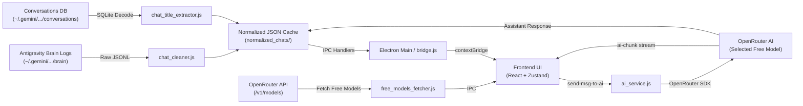

# Antigravity Unified Chat Hub 🌌

A desktop application built with **Electron**, **React 19**, and **Tailwind CSS v4** that aggregates, indexes, searches, and continues chat sessions created by the **Google Antigravity IDE** (`@gemini/antigravity-ide`).

---

## 🚀 Overview

**Antigravity Unified Chat Hub** provides a centralized, modern interface for browsing and interacting with conversations generated across Antigravity IDE sessions. It reverse-engineers and parses local session logs and SQLite databases, normalizes conversations into clean JSON structures, supports instant global and in-chat keyword search, and lets you continue conversations seamlessly using **OpenRouter's unified AI API** with dynamic discovery of all available free-tier models and real-time token streaming.

---

## ✨ Features

- **Session Normalization & Caching**: Automatically discovers local Antigravity brain sessions (`~/.gemini/antigravity-ide/brain/`), filters user requests and assistant responses from `transcript.jsonl`, and caches normalized conversations in `normalized_chats/`.
- **Automated Title Extraction**: Reads Antigravity's internal SQLite conversation databases (`~/.gemini/antigravity-ide/conversations/*.db`) using Node's built-in `node:sqlite` (`DatabaseSync`) to decode session titles from step payloads.
- **Global & In-Chat Search**:
  - Global modal search across all conversation titles and full message contents with debounced indexing.
  - In-chat search with automatic match scrolling and highlight rings.
- **Dynamic Free Model Discovery**:
  - Automatically queries OpenRouter's live API to discover all available 0-cost and `:free` models (Meta Llama, Mistral, NVIDIA Nemotron, DeepSeek, Qwen, Flint, etc.).
  - Interactive model dropdown in the chat input to pick and switch models on the fly.
- **Real-Time Token Streaming**: Streams AI responses token-by-token directly through Electron IPC (`send-msg-to-ai`, `ai-chunk`, `ai-done`), updating the chat view with zero lag.
- **Modern Glassmorphic UI**:
  - Custom dark glassmorphic palette with ambient radial gradients and backdrop blur.
  - Markdown message rendering with syntax-styled code blocks, inline code, and clickable external links.
  - Micro-animations for typing indicators and interactive gradient borders.
- **Secure Electron Architecture**: Context isolation enabled via `contextBridge`, zero direct Node API leakage to the renderer, and safe opening of external hyperlinks in the default OS browser.

---

## 🛠️ Tech Stack

### Core & Backend (Main Process)
- **Runtime**: [Electron](https://www.electronjs.org/) (v44+) & [Node.js](https://nodejs.org/) (v22+ required for native `node:sqlite`)
- **AI Integration**: [@openrouter/sdk](https://www.npmjs.com/package/@openrouter/sdk) (v1.5+)
- **Database / File Handling**: Node.js built-in `node:sqlite` (`DatabaseSync`), `node:fs/promises`, and native ESM

### Frontend (Renderer Process)
- **Framework**: [React 19](https://react.dev/)
- **Build Tool**: [Vite 8](https://vitejs.dev/)
- **Routing**: [React Router DOM v7](https://reactrouter.com/)
- **State Management**: [Zustand 5](https://zustand-demo.pmnd.rs/)
- **Styling**: [Tailwind CSS v4](https://tailwindcss.com/)
- **Markdown & Icons**: `react-markdown`, [Lucide React](https://lucide.dev/)

---

## 📂 Project Structure

```
antigravity_unified_chat_hub/
├── .env                         # OpenRouter API key configuration
├── bridge.js                    # Preload script exposing secure electronAPI & aiAPI
├── index.js                     # Electron main process entry point & IPC handlers
├── utils.js                     # Shared directory paths and file path resolvers
├── services/                    # Backend services (Main Process)
│   ├── ai_service.js            # OpenRouter SDK streaming & chat continuation
│   ├── free_models_fetcher.js   # Live OpenRouter free models discovery
│   ├── chat_cleaner.js          # Raw transcript parser, normalizer, and batch loader
│   ├── chat_title_extractor.js  # SQLite session title decoder using DatabaseSync
│   └── clean_chat_manager.js    # Clean chat reader and full-text disk searcher
├── normalized_chats/            # Normalized JSON chat outputs (cached)
├── frontend/                    # React + Vite application
│   ├── index.html
│   ├── vite.config.js
│   ├── src/
│   │   ├── main.jsx
│   │   ├── App.jsx
│   │   ├── Router.jsx           # App routes (/ and /chat/:id)
│   │   ├── index.css            # Tailwind theme, keyframe animations, scrollbars
│   │   ├── layouts/
│   │   │   └── RootLayout.jsx   # Shell layout with persistent Sidebar & stream listeners
│   │   ├── handlers/
│   │   │   └── aiStreamHandlers.js # Reactive IPC token streaming handlers
│   │   ├── store/
│   │   │   └── AppStore.js      # Global Zustand store (chatList, activeChat, models)
│   │   └── components/
│   │       ├── chat/            # Chat view, header, ModelSelector, input, markdown
│   │       ├── sidebar/         # Conversation history navigation list
│   │       ├── ui/              # Modals (SearchModal, ChatMsgSearchModal), buttons
│   │       └── loader/          # Custom animated TypingLoader
│   └── package.json
└── package.json
```

---

## ⚙️ Getting Started

### Prerequisites

- **Node.js**: **v22.0.0 or higher** (Required for native `node:sqlite` `DatabaseSync` support).
- **Google Antigravity IDE**: Active or existing sessions located in `~/.gemini/antigravity-ide/`.
- **OpenRouter API Key**: A valid API Key from [OpenRouter](https://openrouter.ai/).

### Installation

1. **Clone the repository:**
   ```bash
   git clone https://github.com/FaizaTasneeem/antigravity_unified_chat_hub.git
   cd antigravity_unified_chat_hub
   ```

2. **Install root dependencies:**
   ```bash
   npm install
   ```

3. **Install frontend dependencies:**
   ```bash
   cd frontend
   npm install
   cd ..
   ```

4. **Configure Environment Variables:**
   Create a `.env` file in the root directory:
   ```env
   OPENROUTER_API_KEY=your_openrouter_api_key_here
   ```

---

## 🏃 Running the Application

### Development Mode
Runs the in-process Vite dev server with Electron auto-reloading (`electronmon`):
```bash
npm run dev
```

### Production Mode
1. Build the frontend assets:
   ```bash
   cd frontend
   npm run build
   cd ..
   ```
2. Start the packaged Electron window:
   ```bash
   npm start
   ```

---

## 🔄 How It Works



1. **Discovery & Parsing**: On launch, `chat_cleaner.js` reads conversation directories from the local Antigravity brain directory and parses `transcript.jsonl`.
2. **Title Extraction**: `chat_title_extractor.js` opens corresponding SQLite `.db` files in read-only mode to retrieve the session title.
3. **Caching**: Normalized conversations are saved in `normalized_chats/<id>_output.json` to prevent re-processing on subsequent boots.
4. **IPC Expose**: `bridge.js` exposes secure methods (`getChatList`, `getChatMsg`, `getSearchFileList`, `getFreeModelsList`, `sendMessageToAI`) to the renderer.
5. **Model Discovery**: `free_models_fetcher.js` queries OpenRouter's models catalog to automatically supply all active free-tier models to the frontend selector.
6. **AI Interaction & Streaming**: Submitting a message triggers `ai_service.js`, which streams response chunks back to the UI in real-time and persists the completed dialogue locally.

---

## 📝 License

This project is licensed under the [ISC License](LICENSE).
